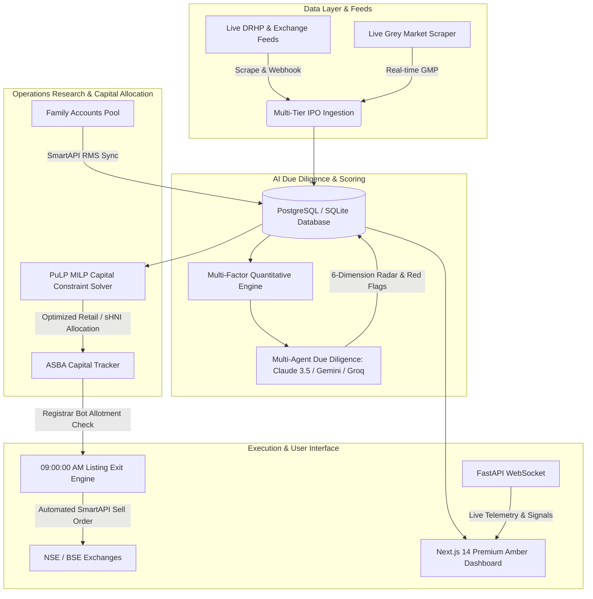

<div align="center">

# ⚡ Kapitl

### Autonomous Multi-Account IPO Intelligence & Trading Engine

[](https://kapital-gamma-nine.vercel.app)
[](https://nextjs.org)
[](https://fastapi.tiangolo.com)
[](https://coin-or.github.io/pulp/)
[](https://smartapi.angelbroking.com)
[](./LICENSE)

<br />

> **Stop guessing which IPO to apply to.**  
> Kapitl scores every Indian IPO with a multi-agent AI pipeline, mathematically allocates family capital across SEBI categories using mixed-integer linear programming, and autonomously executes listing-day exits.

<p align="center">
  <a href="https://kapital-gamma-nine.vercel.app"><strong>Explore Live Product (Guest Preview) »</strong></a>
  <br />
  <a href="#-system-architecture">Architecture</a> •
  <a href="#-key-engineering-decisions">Key Decisions</a> •
  <a href="#-local-setup">Local Setup</a> •
  <a href="#-rest-api-documentation">API Docs</a>
</p>

</div>

---

## 💡 What It Does (In 3 Sentences)

1. **Multi-Agent Due Diligence**: Dual Claude 3.5 & Gemini 2.5 Flash agents analyze 400-page DRHP filings, live Grey Market Premiums (GMP), and peer multiples to output a 6-dimension composite score (0–100) and an Apply/Avoid verdict.
2. **Operations Research Capital Allocation**: A PuLP mixed-integer linear constraint solver models pooled family capital across up to 10 Demat accounts, distributing funds between Retail (≤ ₹2L), sHNI (₹2L–₹10L), and bHNI (> ₹10L) to mathematically maximize expected allotment odds while strictly avoiding duplicate PAN disqualifications.
3. **Autonomous Listing Day Execution**: Background daemons monitor registrar allotment status (Link Intime / KFintech) and fire pre-market limit sell orders at **09:00:00 AM IST** on listing day via Angel One SmartAPI to capture opening listing gains with zero manual intervention.

---

## 🏛 System Architecture

Kapitl runs a high-performance decoupled architecture connecting live financial scrapers, operations research algorithms, multi-agent LLM pipelines, and broker execution APIs:



---

## ⚡ Key Engineering Decisions

- **Multi-Tier Deduplication & Alias Learning**: Built an intelligent two-tier identity resolver to handle irregular symbol name discrepancies across market scrapers (Tier 1: ISIN / Symbol hash match; Tier 2: database alias mapping table with auto-learning stem registration).
- **PuLP Mixed-Integer Linear Programming (MILP)**: Replaced naive equal-split heuristics with an algorithmic constraint solver that models SEBI allotment probability curves, maximizing expected value across pooled family Demat accounts while guaranteeing zero duplicate PAN penalties.
- **Cost-Optimized Multi-Agent Analysis (~₹200/mo)**: Engineered prompt caching, multi-stage LLM batching, and shared report caching so that thorough 400-page DRHP due diligence runs autonomously at minimal operating cost.
- **SEBI ASBA Regulatory Compliance**: Designed the workflow around mandatory Indian banking rules: funds remain locked in the user's savings account earning interest under ASBA until allotment confirmation, before automated SmartAPI listing-day exits trigger.
- **Option A Warm Amber/Dark Design System**: Replaced generic navy fintech styling with a warm slate/amber palette (`#0c0a09` base, `#1a1612` surface, `#f59e0b` primary accent) paired with `DM Sans` headings for high-impact recruiter readability.

---

## 🛠 Tech Stack

| Layer | Technologies | Purpose |
| :--- | :--- | :--- |
| **Frontend** | Next.js 14 (App Router), TypeScript, Tailwind CSS, Lucide | Responsive real-time terminal & public landing page |
| **Backend API** | FastAPI, Python 3.11+, Pydantic v2, Uvicorn | High-throughput asynchronous REST & WebSocket server |
| **Database & ORM** | PostgreSQL 15 / SQLite, SQLAlchemy 2.0 (Async), Alembic | Relational data persistence, foreign key integrity |
| **Optimization** | PuLP, SciPy, NumPy | Mixed-Integer Linear Programming for capital distribution |
| **AI Agents** | Claude 3.5 Haiku, Google Gemini 1.5/2.5 Flash, Groq | Multi-agent forensic DRHP analysis & sentiment auditing |
| **Broker Integration** | Angel One SmartAPI v3, PyOTP (TOTP 2FA) | RMS fund polling, holding sync, pre-market sell orders |
| **Deployment** | Vercel (Next.js & FastAPI Microservices) | Edge CDN, serverless microservices, SSL termination |

---

## 🚀 Quick Local Setup

For detailed setup instructions, please see [SETUP.md](./SETUP.md).

```bash
# 1. Clone the repository
git clone https://github.com/ravi-yadav-23/Kapital.git
cd Kapital

# 2. Setup & start Backend (Terminal 1)
cd apps/api
python -m venv venv
# Windows: .\venv\Scripts\activate | macOS/Linux: source venv/bin/activate
pip install -r requirements.txt
uvicorn app.main:app --reload --port 8000

# 3. Setup & start Frontend (Terminal 2)
cd apps/web
npm install
npm run dev
```

Visit `http://localhost:3000` to access the application locally.

---

## 🧪 Testing & Validation

Kapitl maintains an automated test suite across unit calculations and API integration routes:

```bash
cd apps/api
pytest tests/unit tests/integration -v
```

All 42 test suites validate:
- Multi-tier ISIN/symbol scraper deduplication.
- PuLP family quota optimization algorithms.
- JWT and RFC 6238 TOTP two-factor authentication handlers.
- Automated listing exit order triggers.

---

## 🛡 Security & Credential Protection

- **Zero-Storage for Sensitive Sessions**: Angel One session tokens and TOTP seeds are strictly ignored by `.gitignore` and never committed.
- **RFC 6238 Time-Based OTP**: Admin access protected with hardware authenticator 2FA and strict whitelisting.
- **Demo Preview Mode**: Guest visitors can explore live market data, AI reports, and simulated family portfolios without access to broker API credentials.

---

## 📄 License & Contributing

- Code licensed under the [MIT License](./LICENSE).
- Interested in contributing? Please review our [Contributing Guidelines](./CONTRIBUTING.md).

---

<p align="center">
  <strong>Built with precision by Ravi Yadav</strong><br />
  B.Tech Computer Science & Engineering • Lovely Professional University<br />
  <a href="https://linkedin.com/in/ravi-yadav-23">LinkedIn</a> • <a href="https://github.com/ravi-yadav-23">GitHub</a> • <a href="https://kapital-gamma-nine.vercel.app">Live Demo</a>
</p>
