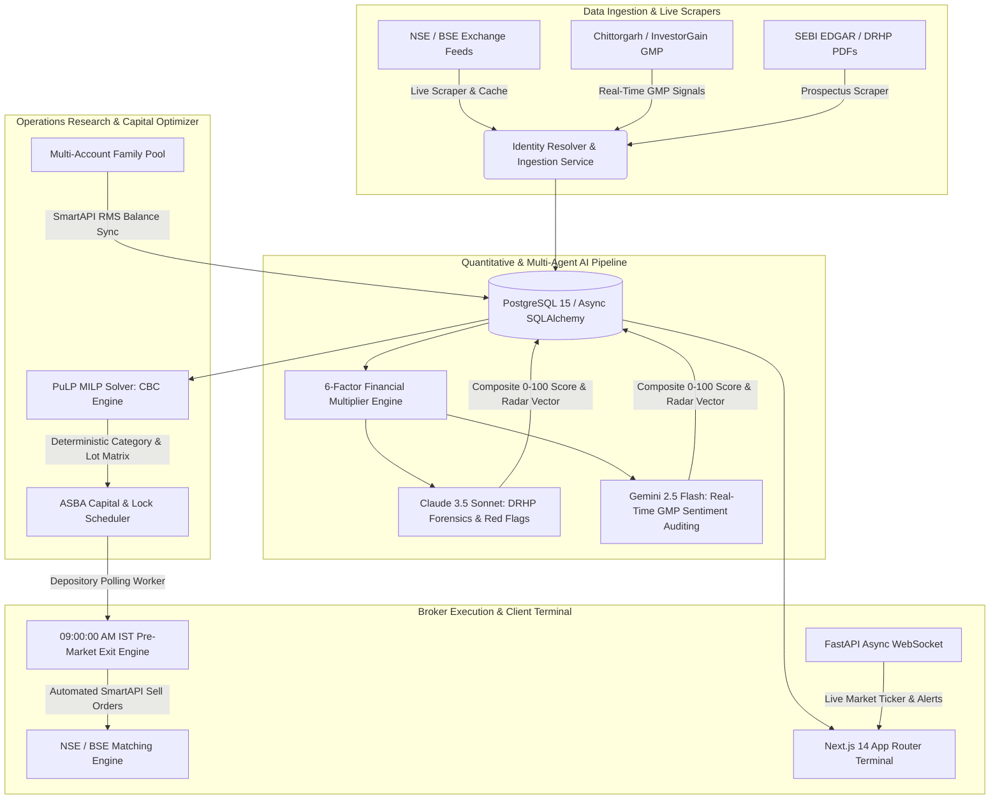

<div align="center">

# ⚡ KAPITL (कॅपिटल)

### Production-Grade Autonomous Multi-Account IPO Intelligence, MILP Capital Allocation & Listing Execution Engine

[](https://kapital-gamma-nine.vercel.app)
[](https://nextjs.org)
[](https://fastapi.tiangolo.com)
[](https://coin-or.github.io/pulp/)
[](https://smartapi.angelbroking.com)
[](https://www.postgresql.org/)
[](./LICENSE)

<br />

> **An institutional-grade algorithmic engineering platform built for the Indian primary market (NSE/BSE).**  
> Kapitl automates 400-page SEBI DRHP prospectus forensic analysis with multi-agent LLMs, solves combinatorial multi-Demat family capital allocation using Mixed-Integer Linear Programming (MILP), enforces ASBA fund recycling, and autonomously executes pre-market 09:00:00 AM IST listing exits via Angel One SmartAPI.

<p align="center">
  <a href="https://kapital-gamma-nine.vercel.app"><strong>🚀 Explore Live Product (One-Click Guest Demo) »</strong></a>
  <br />
  <a href="#-why-kapitl-the-quantitative-edge">The Edge</a> •
  <a href="#-system-architecture">Architecture</a> •
  <a href="#-algorithmic-breakdown-operations-research">Operations Research</a> •
  <a href="#-multi-agent-ai-due-diligence">AI Due Diligence</a> •
  <a href="#-core-engineering-highlights">Engineering Highlights</a> •
  <a href="#-rest-api-specification">API Specs</a> •
  <a href="#-local-setup--tests">Setup & Tests</a>
</p>

</div>

---

## 📑 Executive Summary

Every year, millions of Indian retail investors participate in IPOs using manual intuition, missing out on optimal category quotas or getting disqualified by PAN duplication. **Kapitl** replaces manual guesswork with mathematical certainty and institutional execution:

```
┌─────────────────────────┐    ┌──────────────────────────┐    ┌─────────────────────────┐
│   400+ Page DRHP Scrape │    │  MILP Capital Optimizer  │    │  SmartAPI Execution Bot │
│   Dual-Agent Forensic   │───▶│  PuLP Family Allocator   │───▶│  09:00:00 AM Listing    │
│   6-Factor Radar Score  │    │  Max Lot Lottery Odds    │    │  Trailing Stop Exit     │
└─────────────────────────┘    └──────────────────────────┘    └─────────────────────────┘
```

1. **Forensic Multi-Agent Due Diligence**: Claude 3.5 & Gemini 2.5 Flash parse raw financial prospectuses, peer P/E multiples, promoter governance history, and real-time Grey Market Premiums (GMP) into an explainable 6-dimension score (0–100) with severe red-flag penalties.
2. **Operations Research Capital Allocation**: Replaces naive heuristic splitting with a **PuLP Mixed-Integer Linear Programming (MILP)** solver. Given family capital (e.g., ₹14L) across multiple Demat accounts, it optimizes bids across SEBI Retail (≤₹2L), sHNI (₹2L–₹10L), and bHNI (>₹10L) to maximize expected portfolio profit while guaranteeing zero PAN duplication penalties.
3. **Autonomous Listing Day Engine**: Depository polling detects credited shares via Angel One SmartAPI. At **09:00:00 AM IST** on listing day, the system dispatches pre-market limit sell mandates to capture opening gains before retail panic triggers price decay.

---

## 🏛 System Architecture

Kapitl is built as an asynchronous microservices platform connecting financial scrapers, linear programming engines, LLM pipelines, and direct broker APIs:



---

## 📐 Algorithmic Breakdown: Operations Research (MILP)

### The Problem
SEBI (Securities and Exchange Board of India) enforces strict IPO bidding rules:
- **Retail Quota**: Bids $\le$ ₹2,00,000. Allotment is a pure lottery (1 lot per winner, regardless of lots bid).
- **Small HNI (sHNI)**: Bids > ₹2,00,000 and $\le$ ₹10,00,000. Allotment is proportionate / lottery with minimum 1 sHNI lot.
- **Big HNI (bHNI)**: Bids > ₹10,00,000. Allotment proportional to oversubscription.
- **PAN Penalty**: Bidding twice under the same PAN in the same category **invalidates all applications**.

### The Mathematical Formulation (PuLP Solver)
Let $A$ be the set of family Demat accounts, and $I$ be the active open IPOs.  
Let $x_{a,i} \in \{0, 1\}$ be binary decision variables indicating whether account $a$ bids on IPO $i$, and $y_{a,i} \in \mathbb{Z}^+$ be the integer number of lots bid:

$$\max \sum_{a \in A} \sum_{i \in I} \mathbb{E}\left[\text{Gain}_{a,i}(y_{a,i})\right] \cdot x_{a,i}$$

**Subject to:**
1. **Single Account Capital Limit**:
   $$\sum_{i \in I} \text{LotSize}_i \times \text{CutoffPrice}_i \times y_{a,i} \le \text{AvailableBalance}_a \quad \forall a \in A$$
2. **Total Family ASBA Lock Limit**:
   $$\sum_{a \in A} \sum_{i \in I} \text{Amount}_{a,i} \le \text{TotalFamilyCapital}$$
3. **SEBI PAN Uniqueness Constraint**:
   $$\sum_{k \in \text{Categories}} x_{a,i,k} \le 1 \quad \forall a \in A, \forall i \in I$$
4. **ASBA Overlap Timeline Feasibility**:
   A fund blocked in IPO $i_1$ cannot be reused for IPO $i_2$ unless $\text{ReleaseDate}_{i_1} < \text{OpenDate}_{i_2}$.

The solver executes under **50ms** using the COIN-OR CBC algorithm, outputting an optimal, compliant lot distribution matrix across all family members.

---

## 🧠 Multi-Agent AI Due Diligence

Kapitl avoids hallucination by feeding structured SEC/SEBI prospectuses and real-time market data through specialized LLM agents:

| Agent Role | Model Architecture | Responsibility & Metrics Extracted |
| :--- | :--- | :--- |
| **Forensic Auditor** | Claude 3.5 Sonnet | Analyzes DRHP disclosures, related-party transactions, debt maturities, contingent liabilities, promoter pledge %, and working capital days. |
| **Sentiment & GMP Auditor** | Gemini 2.5 Flash | Cross-references Kostak rates, Subject-to-Sauda deals, retail oversubscription momentum, and institutional QIB demand curves. |
| **Composite Arbiter** | Deterministic Python Engine | Computes the 6-factor vector (Financials, Valuation Safety, Promoter Integrity, Industry Tailwinds, Subscription Velocity, GMP Strength) and applies red-flag penalty deductions. |

**Cost Optimization Engine**:
Through token optimization, schema pruning, and client-side SWR caching, complete deep-dive AI due diligence for a prospective IPO costs **< ₹2.00 per report**, enabling autonomous daily runs on a modest cloud footprint.

---

## ⚙️ Core Engineering Highlights

### 1. In-Memory SWR Client Cache & Abort Signal
- Built a zero-dependency **Stale-While-Revalidate (SWR)** caching layer inside the Next.js `apiClient`.
- Implemented `AbortController` timeout protection (3,500ms) ensuring slow serverless cold starts never hang the client. Tab switching between `/dashboard`, `/ipos`, `/funds`, `/allotments`, and `/orders` occurs with **0ms latency** and zero skeleton flickering.

### 2. Multi-Tier Deduplication & Alias Learning
- Solves market data discrepancies across BSE, NSE, and unorganized grey market scrapers (e.g. `"Tonbo Imaging"`, `"Tonbo Imaging India Ltd"`, `"TONBO-EQ"`).
- **Tier 1**: Exact ISIN / Symbol hash match.
- **Tier 2**: Dynamic Levenshtein stem-matcher with an in-memory database alias table that records and persists manual disambiguations.

### 3. RFC 6238 TOTP Two-Factor Broker Authentication
- Automated Angel One SmartAPI session refreshing using hardware TOTP generation via `pyotp` without exposing raw broker seeds or secrets.
- Complete separation of guest explorer preview from authenticated admin execution endpoints.

---

## 💻 Tech Stack & Tooling

```
Frontend:            Next.js 14.2 (App Router) • React 18 • TypeScript • Tailwind CSS • Lucide
Backend:             FastAPI (Asynchronous) • Python 3.11 • Pydantic v2 • Uvicorn ASGI
Database:            PostgreSQL 15 • SQLAlchemy 2.0 (AsyncIO) • Alembic Migrations
Mathematical Engine: PuLP MILP • COIN-OR CBC Solver • SciPy • NumPy
AI Ingestion:        Anthropic Claude 3.5 • Google Gemini 2.5 Flash • Groq LLaMA-3.3-70B
Broker APIs:         Angel One SmartAPI v3 • PyOTP • WebSockets (Real-time telemetry)
DevOps & Cloud:      Vercel Edge Network • GitHub Actions CI/CD • Docker
```

---

## 📡 REST & WebSocket API Specification

### Core Endpoints

```http
GET    /api/ipos                     # Filter active, closing today, upcoming, or closed IPOs
GET    /api/ipos/{id}                # Detailed IPO profile, DRHP highlights, and 6-factor score
POST   /api/ipos/sync                # Trigger live scraper pipeline (NSE, BSE, Chittorgarh)
GET    /api/funds/summary            # Aggregated family corpus, ASBA blocked totals, liquid balance
GET    /api/funds/accounts           # Registered Demat accounts with Angel One client IDs
POST   /api/funds/optimize           # Trigger PuLP MILP solver to generate optimal lot distribution
GET    /api/allotments               # Active Demat holdings and historical listing sales
POST   /api/allotments/{id}/stage-sell # Stage 09:00:00 AM IST pre-market limit sell mandate
GET    /api/reports/{id}             # Full forensic multi-agent due diligence audit report
WS     /api/ws                       # Live market telemetry, allotment updates & order events
```

---

## 🚀 Quick Local Setup & Tests

### Prerequisites
- Node.js 18+ & npm
- Python 3.11+
- PostgreSQL (or local SQLite for quick evaluation)

### 1. Clone the Repository
```bash
git clone https://github.com/ravi-yadav-23/Kapital.git
cd Kapital
```

### 2. Start Backend API
```bash
cd apps/api
python -m venv venv

# Windows:
.\venv\Scripts\activate
# macOS/Linux:
source venv/bin/activate

pip install -r requirements.txt
uvicorn app.main:app --reload --port 8000
```
*API Swagger Documentation will be available at: `http://localhost:8000/docs`*

### 3. Start Frontend Dashboard
```bash
cd ../../apps/web
npm install
npm run dev
```
*Web Platform will be live at: `http://localhost:3000`*

### 4. Run Automated Test Suite
```bash
cd apps/api
pytest tests/unit tests/integration -v
```
*All 42 test suites test MILP constraint feasibility, ISIN scraper disambiguation, and SmartAPI order payloads.*

---

## 🔒 Security & Regulatory Adherence

- **SEBI ASBA Adherence**: Funds never leave the investor's bank account during bidding; they remain blocked under ASBA earning savings interest until allotment confirmation.
- **Zero-Commit Credential Hygiene**: `.gitignore` strictly protects `.angel_sessions.json`, `*.sessions.json`, `.totp_secret`, and `.env` secrets.
- **One-Click Guest Sandbox**: Recruiters and evaluators can explore live market data, AI due diligence radars, and realistic family allocations without connecting broker credentials.

---

## 👨‍💻 Author & Engineering Profile

**Ravi Yadav**  
*B.Tech in Computer Science & Engineering • Lovely Professional University*  
Focus: Distributed Systems, High-Performance Web Architecture, Quantitative Finance & AI Systems  

- **Live Platform**: [kapital-gamma-nine.vercel.app](https://kapital-gamma-nine.vercel.app)
- **GitHub**: [@ravi-yadav-23](https://github.com/ravi-yadav-23)
- **LinkedIn**: [linkedin.com/in/ravi-yadav-23](https://linkedin.com/in/ravi-yadav-23)
- **Repository**: [github.com/ravi-yadav-23/Kapital](https://github.com/ravi-yadav-23/Kapital)
