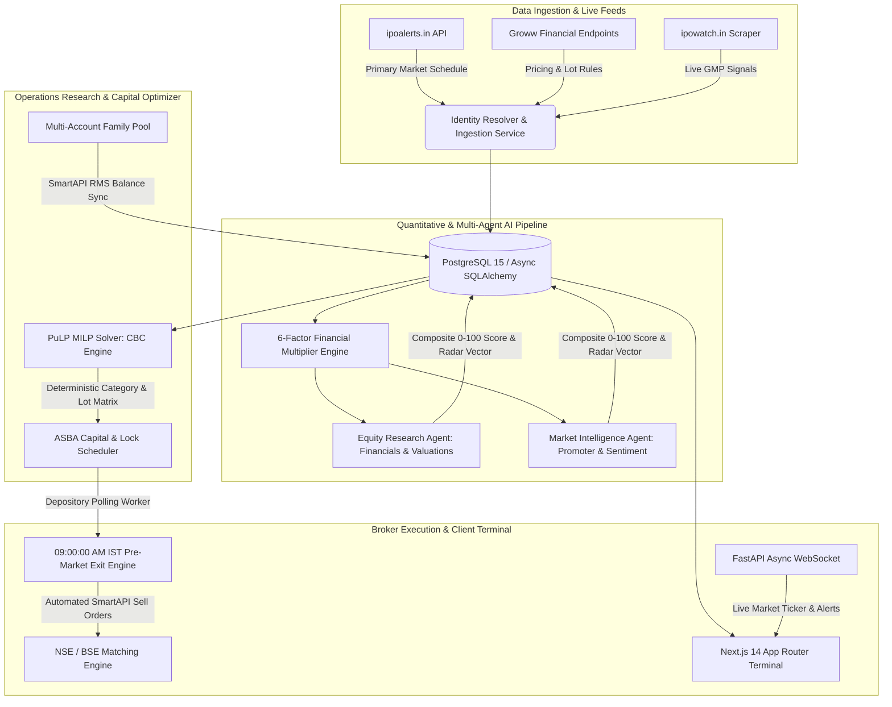

<div align="center">

# ⚡ KAPITL 

### Production-Grade Autonomous Multi-Account IPO Intelligence, MILP Capital Allocation & Pre-Market Execution Engine

[](https://kapital-gamma-nine.vercel.app)
[](https://nextjs.org)
[](https://fastapi.tiangolo.com)
[](https://coin-or.github.io/pulp/)
[](https://smartapi.angelbroking.com)
[](https://www.postgresql.org/)
[](./LICENSE)

<br />

> **A FastAPI + Next.js planning and tracking tool for Indian retail IPO investors (NSE/BSE).**  
> Kapitl combines IPO feed data and grey-market signals with an LLM summary, a heuristic MILP capital allocator across family demat accounts, ASBA lock tracking, and scheduled Angel One SmartAPI listing-day sell staging. Prospectus (DRHP) parsing is not implemented, and broker order placement has not been verified against a live account.

<p align="center">
  <a href="https://kapital-gamma-nine.vercel.app"><strong>🚀 Explore Live Product (One-Click Guest Demo) »</strong></a>
  <br />
  <a href="#-executive-summary">The Edge</a> •
  <a href="#-system-architecture">Architecture</a> •
  <a href="#-algorithmic-breakdown-operations-research-milp">Operations Research</a> •
  <a href="#-multi-agent-ai-due-diligence">AI Due Diligence</a> •
  <a href="#-core-engineering-highlights">Engineering Highlights</a> •
  <a href="#-rest-api-specification">API Specs</a> •
  <a href="#-quick-local-setup--tests">Setup & Tests</a>
</p>

</div>

---

## 📑 Executive Summary

Every year, millions of Indian retail investors participate in IPOs using manual intuition, missing out on optimal category quotas or getting disqualified by PAN duplication. **Kapitl** replaces spreadsheet guesswork with a rules-aware optimizer and scheduled execution tooling (heuristic, not a guarantee of allotment or profit):

```
┌─────────────────────────┐    ┌──────────────────────────┐    ┌─────────────────────────┐
│ Structured Data & Feeds │    │  MILP Capital Optimizer  │    │  SmartAPI Execution Bot │
│ Multi-Agent Due Diligence│───▶│  PuLP Family Allocator   │───▶│  09:00:00 AM Listing    │
│ 6-Factor Radar Score    │    │  Max Lot Lottery Odds    │    │  Pre-Market Limit Exit  │
└─────────────────────────┘    └──────────────────────────┘    └─────────────────────────┘
```

1. **AI-assisted IPO scoring**: an LLM (Groq `openai/gpt-oss-120b` by default; Anthropic Claude or Google Gemini can be selected in Settings, one provider at a time) summarises the IPO's feed metadata (price band, lot size, GMP, subscription, listed strengths and risks). Market-signal components (GMP, subscription) are computed deterministically. Anything the model cannot be given - restated financials, peer multiples, OFS split, litigation - is shown as **not assessed**; prospectus (DRHP/RHP) parsing is not implemented.
2. **Heuristic capital allocation (PuLP MILP)**: given family balances across demat accounts, ranks bids across SEBI Retail (≤₹2L), sHNI (₹2L–₹10L) and bHNI (>₹10L) by a GMP × score weighting, with per-account budgets, one bid per PAN within a plan, a reservation of capital for high-score upcoming IPOs, and UPI-vs-net-banking tagging (UPI is capped at ₹5L per bid). The objective is a ranking heuristic, **not** expected profit: it has no allotment-probability model, so it makes no profit or allotment guarantee.
3. **Listing-day sell staging (self-hosted scheduler or GitHub Actions cron)**: holdings credited in the demat are detected via Angel One SmartAPI (exact ISIN/symbol matching) and the sell limit price you stage is submitted around 09:00 IST on listing day, with a 10:05 reconciliation that books P&L only from real broker fills. Timing is best-effort, and the broker calls have not been verified against a live account.

---

## 🏛 System Architecture

Kapitl is built as an asynchronous platform connecting verified primary market feeds, linear programming engines, LLM pipelines, and direct broker APIs:



---

## 📐 Algorithmic Breakdown: Operations Research (MILP)

### The Problem
SEBI (Securities and Exchange Board of India) enforces strict IPO bidding rules:
- **Retail Quota**: Bids $\le$ ₹2,00,000. Allotment is a pure lottery (1 lot per winner, regardless of lots bid).
- **Small HNI (sHNI)**: Bids > ₹2,00,000 and $\le$ ₹10,00,000. Allotment is proportionate / lottery with minimum 1 sHNI lot.
- **Big HNI (bHNI)**: Bids > ₹10,00,000. Allotment proportional to oversubscription.
- **PAN Penalty**: Bidding twice under the same PAN in the same category **invalidates all applications**.

### The Mathematical Formulation (PuLP Solver)
Let $A$ be the set of family Demat accounts, and $I$ be the active open IPOs.  
Let $x_{a,i} \in \{0, 1\}$ be binary decision variables indicating whether account $a$ bids on IPO $i$, and $y_{a,i} \in \mathbb{Z}^+$ be the integer number of lots bid:

$$\max \sum_{a \in A} \sum_{i \in I} \mathbb{E}\left[\text{Gain}_{a,i}(y_{a,i})\right] \cdot x_{a,i}$$

**Subject to:**
1. **Single Account Capital Limit**:
   $$\sum_{i \in I} \text{LotSize}_i \times \text{CutoffPrice}_i \times y_{a,i} \le \text{AvailableBalance}_a \quad \forall a \in A$$
2. **Total Family ASBA Lock Limit**:
   $$\sum_{a \in A} \sum_{i \in I} \text{Amount}_{a,i} \le \text{TotalFamilyCapital}$$
3. **SEBI PAN Uniqueness Constraint**:
   $$\sum_{k \in \text{Categories}} x_{a,i,k} \le 1 \quad \forall a \in A, \forall i \in I$$
4. **ASBA Overlap Timeline Feasibility**:
   A fund blocked in IPO $i_1$ cannot be reused for IPO $i_2$ unless $\text{ReleaseDate}_{i_1} < \text{OpenDate}_{i_2}$.

The solver runs the COIN-OR CBC algorithm; if it cannot finish, the plan falls back to a greedy heuristic and says so in the plan warnings.

---

## 🧠 Multi-Agent AI Due Diligence

Kapitl avoids hallucination by feeding verified primary market attributes through specialized LLM agents with strict schema enforcement:

| Agent Role | Model Architecture | Responsibility & Metrics Extracted |
| :--- | :--- | :--- |
| **Equity Research Agent** | Configured provider (default Groq `openai/gpt-oss-120b`) | Reads price band, lot size, issue size, listed strengths and risks. Financial series, P/E, OFS split and litigation are **not** supplied and are reported as not assessed. |
| **Market Intelligence Agent** | Configured provider (default Groq `openai/gpt-oss-120b`) | Reads subscription multiples (Retail, sHNI, bHNI, QIB) and the grey market premium. No news or promoter data is supplied, so promoter/industry scores are null unless the model can justify them from the input. |
| **Composite Arbiter** | Deterministic Python Engine | Computes the 6-factor vector (Financial Quality, Valuation Safety, Promoter Integrity, Industry Tailwinds, Subscription Velocity, GMP Strength) and applies red-flag penalty deductions. |

**Anti-Hallucination & Transparency Policy**:
- When financial series (revenue, PAT, CFO) are not available in structured primary feeds, fields are strictly returned as `null` rather than fabricated.
- Every report generated from preliminary disclosures is labeled with `data_sufficiency: partial` and a prominent disclosure: `[AI summary from limited inputs]`.

---

## ⚙️ Core Engineering Highlights

### 1. In-Memory SWR Client Cache & Abort Signal
- Built a zero-dependency **Stale-While-Revalidate (SWR)** caching layer inside the Next.js `apiClient`.
- Implemented `AbortController` timeout protection ensuring slow connections or cold starts never freeze client navigation.

### 2. Multi-Tier Deduplication & Scrip Disambiguation
- Solves market data discrepancies across multiple feeds (`"Tonbo Imaging"`, `"Tonbo Imaging India Ltd"`, `"TONBO-EQ"`).
- **Tier 1**: Exact ISIN match (gold standard).
- **Tier 2**: Dynamic normalized stem-matching with an in-memory database alias table.

### 3. Strict Role-Based Data Isolation
- Single `get_viewer` dependency enforces zero data leakage: unauthenticated or guest callers receive completely isolated, non-sensitive demo fixtures.
- Sensitive live account information (balances, broker credentials, client IDs, and unmasked PANs) is strictly accessible only to verified administrators.
- Automatic PAN masking (`A*****234F`) across all external API responses.

### 4. SmartAPI RFC 6238 TOTP Integration & Distributed Locks
- Automated Angel One SmartAPI session management using hardware TOTP generation via `pyotp`.
- A Redis-backed job lock (falling back to a per-process lock when Redis is unavailable) reduces duplicate runs of scheduled jobs. It is best-effort, not an exactly-once guarantee, and has not been exercised against a live broker.

---

## 💻 Tech Stack & Tooling

```
Frontend:            Next.js 14.2 (App Router) • React 18 • TypeScript • Tailwind CSS • Lucide
Backend:             FastAPI (Asynchronous) • Python 3.10–3.12 • Pydantic v2 • Uvicorn ASGI
Database:            PostgreSQL 15 • SQLite (Local dev/testing) • SQLAlchemy 2.0 (AsyncIO)
Optimization:        PuLP MILP • COIN-OR CBC Solver
AI summaries:        Groq openai/gpt-oss-120b (default) • Anthropic Claude • Google Gemini (one provider at a time)
Broker APIs:         Angel One SmartAPI v3 • PyOTP • WebSockets (Real-time telemetry)
DevOps & Cloud:      Vercel • GitHub Actions CI/CD • Docker
```

---

## 📡 REST & WebSocket API Specification

### Core Endpoints

```http
GET    /api/ipos                       # Filter active, closing today, upcoming, or closed IPOs
GET    /api/ipos/{id}                  # Detailed IPO profile, prospectus highlights, and 6-factor score
POST   /api/ipos/sync                  # Trigger live feed ingestion (ipoalerts, Groww, ipowatch)
GET    /api/funds/summary              # Aggregated family corpus, ASBA blocked totals, liquid balance
GET    /api/funds/accounts             # Registered Demat accounts (masked PAN); sample data unless signed in as admin
POST   /api/funds/optimize             # Trigger PuLP MILP solver to generate optimal lot distribution
GET    /api/allotments                 # Active Demat holdings and historical listing sales
POST   /api/allotments/{id}/stage-sell # Stage 09:00:00 AM IST pre-market limit sell mandate
GET    /api/reports/{id}               # Full forensic multi-agent due diligence audit report
WS     /api/ws                         # Live market telemetry, allotment updates & order events
```

---

## 🚀 Quick Local Setup & Tests

### Prerequisites
- Node.js 22+ & npm (18.18+ is enough for the build, 22+ for `npm test`)
- Python 3.10–3.12 (3.13 is not supported by the pinned requirements)
- `uv` (recommended) or `pip`
- PostgreSQL (or local SQLite for quick evaluation)

### 1. Clone the Repository
```bash
git clone https://github.com/ravi-yadav-23/Kapital.git
cd Kapital
```

### 2. Start Backend API
```bash
cd apps/api
# Using uv (recommended):
uv run uvicorn app.main:app --reload --port 8000

# Or standard virtualenv:
python -m venv venv
.\venv\Scripts\activate   # Windows
# source venv/bin/activate # macOS/Linux
pip install -r requirements.txt
uvicorn app.main:app --reload --port 8000
```
*API Swagger Documentation is available at: `http://localhost:8000/docs`*

### 3. Start Frontend Dashboard
```bash
cd ../../apps/web
npm install
npm run dev
```
*Web Platform is live at: `http://localhost:3000`*

### 4. Run Automated Test Suite
```bash
cd apps/api
uv run pytest tests -v
```
*121+ automated tests covering role-based data isolation, PAN masking, MILP ASBA timeline feasibility, SmartAPI order payloads, and partial allotment fund reconciliation.*

---

## 🔒 Security & Regulatory Adherence

- **SEBI ASBA Adherence**: Funds never leave the investor's bank account during bidding; they remain blocked under ASBA earning savings interest until allotment confirmation.
- **Zero-Commit Credential Hygiene**: `.gitignore` strictly protects `.angel_sessions.json`, `*.sessions.json`, `.totp_secret`, and `.env` secrets.
- **Isolated Guest Explorer Sandbox**: Recruiters and evaluators can safely explore live market data, AI due diligence radars, and realistic family allocations without access to live trading credentials.

---

## 👨‍💻 Author & Engineering Profile

**Ravi Yadav**  
*B.Tech in Computer Science & Engineering • Lovely Professional University*  
Focus: Distributed Systems, High-Performance Web Architecture, Quantitative Finance & AI Systems  

- **Live Platform**: [kapital-gamma-nine.vercel.app](https://kapital-gamma-nine.vercel.app)
- **GitHub**: [@ravi-yadav-23](https://github.com/ravi-yadav-23)
- **LinkedIn**: [linkedin.com/in/ravi-yadav-23](https://linkedin.com/in/ravi-yadav-23)
- **Repository**: [github.com/ravi-yadav-23/Kapital](https://github.com/ravi-yadav-23/Kapital)
